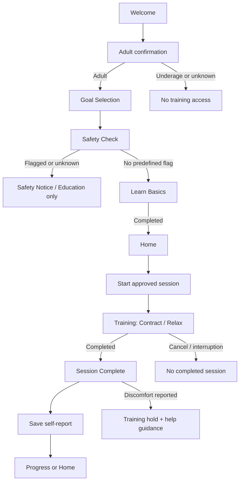

# Control — PRD.md

> **Product Requirements Document / 产品需求文档**  
> **版本：** 0.2.0 · 12-screen Gradient UI Baseline  
> **日期：** 2026-10-23  
> **产品：** Control — Men's Pelvic Floor Training  
> **平台：** iPhone / iOS 17+ / SwiftUI  
> **App 语言：** 英语优先；开发文档：中文  
> **配套文档：** `DESIGN.md`、`USER_FLOW.md`  
> **设计参照：** `References/control-ui-12screens.png`  
> **状态：** 开发规格草案，非经过临床审核的训练/筛查方案。

---

## 0. 文档职责与执行约束

本文件负责定义：**给谁使用、解决什么问题、做什么功能、什么不做、验收条件是什么。**

- `PRD.md`：目标、功能边界、优先级、数据真实性、验收。
- `USER_FLOW.md`：页面路由、状态机、操作、异常与权限守卫。
- `DESIGN.md`：渐变色系统、字体、组件、页面布局、动画与可访问性。
- 12 屏参考图：**视觉方向**；其中的演示日期、训练时长、练习量、成绩、医学文字不能直接视为真实业务数据或临床建议。
- 冲突优先级：**用户健康安全和审核结果 > PRD 业务规则 > USER_FLOW 流程状态 > DESIGN 视觉样式 > 参考图。**

**重要定义：** 本版本同时描述完整的 **12 屏目标体验** 和可先交付的 **MVP（P0）**。图上存在的控件 ≠ 当前版本全部上线。未实现或未经审核的功能，不允许出现能点击却无效的入口。

---

## 1. 产品定位

### 1.1 一句话定义

Control 是为成年男性设计的盆底肌健康教育与基础练习引导 App，通过**动作教学、清楚的收缩/放松阶段、自然呼吸提示、训练记录及反馈**，支持用户养成规律练习习惯。

- **品牌：** Control（正式发布前检索名称、商标和 App Store 命名可用性）。
- **Tagline：** `Train Control. Learn to Relax.`
- **英文短描述：** `Guided pelvic floor practice for men.`
- **首发目标市场假设：** 英语用户，主要验证 25–45 岁成年男性需求；不宣称已经完成付费市场验证。
- **定位边界：** 不是诊断工具，不是治疗或术后康复处方，不声称训练能保证改善勃起功能、射精控制、疼痛或排尿症状。

### 1.2 三个产品承诺

1. **Learn：** 用可理解的图文与动画教会用户分辨“收缩”和“充分放松”。
2. **Train：** 用明确的分阶段计时、语音/振动反馈辅助练习，并允许随时暂停/停止。
3. **Progress：** 真实记录练习次数、训练天数、时长和用户自行填写的感受；不推断无法直接测量的肌肉力量。

### 1.3 核心用户需求

- 第一次接触盆底肌训练：不知道肌肉位置、如何正确动作。
- 想规律练习：缺乏清晰的开始流程、引导和习惯记录。
- 希望使用私密工具：偏好**离线使用、无强制登录、最少必要数据**。
- 安全边界：有疼痛、排尿问题、近期手术等情况时，需要明确的非诊断提示和专业求助建议。

### 1.4 不解决的问题

- 不对盆底功能进行诊断或判断“肌肉弱/紧”。
- 不使用手机动画/手指点击来宣称检测到了实际盆底肌活动。
- 不提供未经审核的治疗方案、术后运动处方或保证性的性健康疗效承诺。
- 不将自我报告的“Easy / Good / Challenging / Too hard”当作客观肌肉强度结果。

---

## 2. 信息架构：5 个一级 Tab、12 张目标屏

### 2.1 主导航（底部 Tab Bar）

| Tab | 用户问题 | 内容 | 首版 |
|---|---|---|---|
| **Home** | 我今天该做什么？ | 今日训练入口、本周完成日期、简要统计 | P0 |
| **Learn** | 怎样正确、安全地练习？ | 基础原理、收缩、放松、呼吸、常见错误 | P0 |
| **Train** | 我要练什么？ | 基础 Session 入口；后续课程选择与 Routine | P0 基础/P1 扩展 |
| **Progress** | 我练了多少？ | 实际训练次数、累计时长、日历、连续天数 | P0 |
| **Settings** | 如何调整和管理？ | 声音、振动、数据删除、隐私与安全信息 | P0 |

首次引导页和正式 Training/Session Complete 不显示常驻底部 Tab。`My Routine`、`Choose a Session` 属于 Train 的二级页面；`Your Journey` 属于 Progress 的二级页面。

### 2.2 参考图 12 屏映射

| 图中序号 | UI 标题 | SwiftUI 页面名 | 导航位置 | 功能优先级 |
|---:|---|---|---|---|
| 1 | Welcome | `WelcomeView` | Onboarding | P0 |
| 2 | What's your main goal? | `GoalSelectionView` | Onboarding | P0 |
| 3 | Health & Safety Check | `SafetyCheckView` | Onboarding | P0 |
| 4 | Good morning / Home | `HomeView` | Home Tab | P0 |
| 5 | Standard Session | `TrainingView` | Training 全屏 | P0（仅审核通过的基础模板） |
| 6 | Session Complete | `SessionCompleteView` | Training 完成页 | P0 |
| 7 | Your Progress | `ProgressView` | Progress Tab | P0 |
| 8 | Learn | `LearnView` / `LessonDetailView` | Learn Tab | P0 |
| 9 | Your Plan | `MyRoutineView` | Train 二级页 | P1 |
| 10 | Choose a Session | `ChooseSessionView` | Train 二级页 | P1（初版单一基础入口） |
| 11 | Settings | `SettingsView` | Settings Tab | P0，提醒 P1 |
| 12 | Your Journey | `JourneyView` | Progress 二级页 | P2 |

**补充的逻辑页：** `AdultConfirmationView` 可并入 Welcome 后的弹页；`LearnBasicsView` 可复用 Learn 的指定内容；`SafetyNoticeView`、`ExitTrainingConfirmation` 是必需的安全/异常状态，但不额外计入原型 12 屏。

---

## 3. 版本范围和开发策略

### 3.1 P0 — 最小可用 MVP（优先实现）

- Welcome + 年龄确认 + 目标选择。
- 安全筛查、受限教育模式、训练入口守卫。
- 训练前必读基础教学与完成标记。
- 5 Tab 导航的基本骨架与真实入口。
- Home：今日训练 CTA、真实记录驱动的日历/统计、空状态。
- Training：Contract/Relax 阶段、次数和剩余时间、暂停/恢复/退出、声音/振动开关生效、后台自动暂停。
- Session Complete：完成次数、有效练习时长、主观难度、独立疼痛/不适反馈。
- Progress：累计 Session、训练时间、训练日、连续练习天数；无数据空状态。
- Learn：基础教学内容及帮助页面。
- Settings：声音、振动、重新查看安全信息、隐私政策、删除本地数据。
- SwiftData/本地持久化；不联网也能完成整个训练流程。

**P0 的可发布前提：** 风险筛查、训练说明、模板参数、风险文案和隐私政策须由相应专业人员审查确认。未确认时仅做内部原型验证，不对外宣称医学有效性。

### 3.2 P1 — 完整训练体验

- `ChooseSessionView` 的 Quick / Standard / Extended **经过审核后**分别上线。
- `MyRoutineView`：周安排、休息日、今日计划、按实际数据标记完成。
- 自定义练习参数（必须存在合理的已审核上下限；不鼓励过量练习）。
- 本地训练提醒：明确申请系统通知许可，默认关闭。
- 根据实际记录计算的扩展周/月趋势与简单 Insights。
- 更多 Learn 内容、语音引导选择与配套动效。

### 3.3 P2 — 产品成长与商业验证

- Journey 长期旅程、里程碑和更丰富的习惯反馈。
- 训练游戏化/成就：仅表征**完成练习或交互行为**，不表征身体真实肌力。
- 经过验证的更多训练课程；可选订阅。
- 账号同步、跨设备历史、可选 Apple Watch / 外部生物反馈设备（须另做技术和隐私论证）。

**明确不做：** AI 临床诊断、通过手机直接测量盆底肌收缩、保证性功能改善、虚构训练成功率。

---

## 4. 核心业务需求（Functional Requirements）

### FR-01 · 首次使用引导（P0）

- 欢迎页呈现品牌与 `Get Started`；主 CTA 必须能进入下一步。
- 明确年龄条件：用户未确认已满 18 岁不得访问训练；未成年或拒答可看到解释和退出，不得继续训练。
- Goal 单选：`Improve control`、`Better performance`、`General pelvic health`。
- 原型中的 `Post-surgery support` **不得自动进入通用强化训练**；若保留，应标记 `Education only / Consult a clinician` 并进入安全提示。实际 Goal 可以单独存为 `recovery_information`。
- 当流程中断并重新打开 App，应回到尚未完成的必要步骤。
- 不将 Goal 文案写成可承诺的健康效果。

**验收：** 未通过完整首次使用链路不能通过切换 Tab/冷启动/返回手势进入 Training。

### FR-02 · Safety & Education Gate（P0）

- 安全筛查内容参见 `USER_FLOW.md`，不能用其作临床诊断。
- 对疼痛、排尿困难、近期手术/医生限制等风险，进入安全提醒与一般教育模式。
- 存储最小的整体状态，不长期保留每题原始敏感答案。
- 核心教学须明确：练习是轻柔尝试、呼吸自然、完全放松、出现疼痛立即停止。
- 用户明确完成基础教学后才允许训练。
- 用户报告练习不适时，设置 `trainingHold`，并禁用后续训练入口，显示求助建议；恢复规则需经专业人员确认，不提供“随便点一下就解除”的绕过。

**验收：** 风险/未知状态时所有训练入口一致不可用；Learn、隐私、设置等一般内容仍可用。

### FR-03 · Home（P0）

- 动态问候和当前本地日期；不能固定使用截图中的 `Tue, Mar 25`。
- 显示本周七日的真实训练完成状态（定义：某日有 ≥1 个完成会话）。
- `Today's Training` 指向已审核的基础模板；若 gate 不通过则改为 `Review safety information` 等明确提示。
- 显示总完成次数、连续训练天数和累计时长中的合理子集；无数据时展示 `No sessions yet`。
- Home 中的假按钮/不可用 Routine 链接必须隐藏或替换为现有功能。

### FR-04 · Training Engine（P0，最关键）

**输入：** 经过专业审核的 `TrainingTemplate`，包含 Contract 秒数、Relax 秒数、重复次数、组数、组间休息，以及版本标记。

**状态：** `idle → preparing → contracting ↔ relaxing → restingBetweenSets（可选） → completed`；随时可 `paused`，用户主动放弃进入 `cancelled`；生命周期意外结束记录为 `interrupted`。

**最低体验要求：**
- 圆环动画表示**预定倒计时进度**，不能冒充传感器读数。
- 中心醒目显示 `Contract` 或 `Relax`、剩余秒数、秒单位；下方显示进度与剩余时间。
- 开始 / 暂停 / 继续 / 退出；退出时弹出确认，不把放弃训练计为完成。
- 正常呼吸提示贯穿全程；避免“越用力越好”“屏气用力”等导向。
- App 进入后台、来电干扰、音频中断时自动暂停，返回前台需要主动 Resume。
- 计时使用单调时间锚点计算经过时长，不能单靠 Timer 每次精确回调扣减。
- 不允许重复按键产生多个计时任务或重复保存。

**模板参数说明：** 原型上的 `8 min`、`4 seconds`、`3/8` 都是**视觉样例**；上线值来自审核后的训练模板，不得因截图而硬编码。

### FR-05 · Session Complete（P0）

- 正常训练完成时，立即创建唯一 UUID 的 `TrainingSession`，先落盘，再展示完成页。
- 展示真实 `Completed Reps`、`Practice Duration`；难度来自用户自我评价，不由系统测量。
- 难度为单选，可跳过：`Easy / Comfortable / Challenging / Too hard`。
- 必须独立询问 `Did you experience pain or discomfort?`：`No / Yes / Prefer not to say`。**不能只靠备注框替代**。
- 如果报告 Yes，保存自报结果并触发训练暂停标记与求助提示（解除与转介措辞待审核）。
- `Save & Continue` 必须幂等：反复点击、返回重进或 App 重启不得新增训练次数。
- Notes 若存在，属于敏感自由文本：V0.1 建议不保存或默认关闭；未来提供明确用途和清除机制。

### FR-06 · Learn（P0）

- `Basics`：盆底肌结构与功能的一般知识。
- `How to`：尝试收缩/完全放松、呼吸与肌肉代偿提醒。
- `Common Mistakes`：憋气、臀腹过度用力、疼痛仍坚持、训练过量等风险。
- 训练入门教育应包含可完成的必修内容，完成状态持久化；不使用医学测试判定用户是否“掌握”。
- 图示应标记 `Illustration / not a diagnostic tool`；医学插图经审核后使用。

### FR-07 · Progress（P0）

- 所有指标来自 `status == completed` 的真实会话；取消/中断不算完整训练。
- 指标：`Total Sessions`、`Practice Minutes`、`Active Training Days`、`Current Streak`。
- `Streak` 以用户日历日期及其本地时区计算；需定义跨时区处理策略和测试用例。
- 可按最近 7 天 / 30 天查看真实记录；`3M / 1Y` 仅当实现完整查询后展示。
- 用户删除数据后所有指标与图表恢复空状态；不得保留截图占位值。
- 感受反馈可以做主观统计，但明确是 `Self-reported`，不是健康改善指数。

### FR-08 · Settings & Privacy（P0）

- `Sound guidance`、`Haptic feedback` 开关即时生效并本地持久化。
- 访问 `Safety information`、`Privacy policy`；隐私政策上线前须真实可访问。
- `Delete all local data` 二次确认；清理本地练习历史及相关设置，符合已声明的数据清理范围。
- 不强制注册、不默认上传性健康数据、不接入广告跟踪 SDK。
- 提醒、语音包、导出数据和账号/订阅入口仅在真实实现后显示。

### FR-09 · My Routine / Session Selection（P1）

- 将图中 `Your Plan` 与 `Choose a Session` 作为 **Train 二级信息架构**，不要提升到第六个 Tab。
- Session 选择卡必须展示真实标题、预计时长、练习内容和可用条件。
- Quick / Standard / Extended 训练模式经过审核后配置各自参数，避免仅更改 UI 标题而使用相同隐式训练。
- Routine 显示用户已选择的训练日、已完成的历史进度；计划完成率分母必须明确，不能虚构。
- 休息日、关闭提醒和改变计划应有明确保存反馈。

### FR-10 · Your Journey（P2）

- 是 Progress 的情绪化长期可视化；用真实里程碑和积累时长填充。
- 山景、路径、节点仅代表**训练坚持和习惯**，不代表盆底健康水平。
- 允许全空、新手与长期用户三种状态；绝不能在新账户显示 `180 sessions / 24 weeks` 的示例数字。

---

## 5. 核心流程（摘要）



详细路由和状态枚举以 `USER_FLOW.md` 为准。

---

## 6. 数据模型（最小可落地）

```swift
// 逻辑草图，非可直接编译代码
UserPreferences {
  adultConfirmed: Bool
  primaryGoal: Goal?
  onboardingStep: OnboardingStep
  onboardingCompleted: Bool
  basicEducationCompleted: Bool
  safetyAccessStatus: SafetyAccessStatus // notScreened, noFlag, educationOnly
  trainingHold: Bool
  soundEnabled: Bool
  hapticsEnabled: Bool
}

TrainingTemplate {
  id: String
  title: String
  contractionSeconds: Int
  relaxationSeconds: Int
  repetitionsPerSet: Int
  setCount: Int
  restBetweenSetsSeconds: Int
  contentReviewVersion: String
  isApprovedForRelease: Bool
}

TrainingSession {
  id: UUID
  templateID: String
  startedAt: Date
  endedAt: Date?
  activeDurationSeconds: Int
  completedRepetitions: Int
  status: SessionStatus // completed / cancelled / interrupted
}

SessionFeedback {
  sessionID: UUID // 唯一关联
  subjectiveDifficulty: Difficulty?
  discomfortReported: Bool? // nil = 未回答
}
```

**建议技术实现：** SwiftUI + `NavigationStack` / `TabView` + SwiftData（训练记录）+ `@AppStorage`（非敏感偏好）+ 状态驱动 `TrainingEngine`。如涉及敏感信息存储，需评估设备锁定/本地保护和备份策略；具体以隐私审核决定。

### 6.1 统计规则

- `totalSessions = count(completed sessions)`。
- `practiceMinutes` 来自累计 `activeDurationSeconds`，展示时说明取整规则。
- `activeTrainingDays` = 有有效完成会话的不同本地日期数。
- `currentStreak` = 从今天或昨天最近一次完成日期向前连续的训练日数量；定义需在测试中固定，不允许各页面不同。
- `selfReportedDifficulty` 与 `discomfortReported` 不能转化为“改善百分比”。

### 6.2 数据删除与重置

- 重置前用户二次确认；实现后重置所有本地会话、反馈和 Onboarding 状态（或允许单独重置历史，但必须区分）。
- 不得声称能从已经同步到用户系统备份的所有副本中立即彻底删除。
- 对开发调试演示数据必须标记 `Preview-only`，正式 App 默认零记录。

---

## 7. 非功能需求

| 类别 | 要求 |
|---|---|
| 设备 | 以 iPhone 竖屏为主；动态尺寸适配较小屏幕和 Pro Max |
| 系统 | iOS 17+；SwiftUI 原生，优先 SF Symbols / SF Pro |
| 可访问性 | Dynamic Type、VoiceOver、足够点击区域、Reduce Motion、颜色不是唯一反馈 |
| 性能 | 开始训练和按钮响应及时；动画流畅，暂停/恢复计时可靠 |
| 网络 | P0 无网络也可完成引导、训练和查看历史；隐私外链例外 |
| 隐私 | 默认最少数据；无强制账号；不内置广告跟踪 SDK |
| 安全 | 所有进入 Training 的路径应用同一 gate；风险/不适处理一致 |
| 真实性 | 所有统计有本地数据来源；不能上线虚构样例数据 |
| 文案 | 英文短句易懂；医学性文字及训练参数必须专业审核 |

---

## 8. 里程碑及 Definition of Done

### Milestone A — UI Skeleton（可先开发）

- [ ] 创建 SwiftUI 工程结构、5 Tab 导航骨架、页面路由。
- [ ] 建立设计 Token、渐变背景、卡片、按钮、图标、Tab Bar。
- [ ] 完成 `HomeView`、`TrainingView`、`SessionCompleteView` 的可交互视觉稿。
- [ ] 所有显示数字使用 `Preview` 假数据或真实本地记录，不混淆。

### Milestone B — Safe MVP Loop

- [ ] 加入首次引导、年龄确认、安全筛查与 Basic Education gate。
- [ ] 训练状态机覆盖 Contract / Relax / Pause / Resume / Cancel / Complete。
- [ ] 后台自动暂停，完成会话唯一保存，取消不计入完成。
- [ ] 痛感反馈独立处理；风险用户无法绕过训练限制。

### Milestone C — MVP Public Readiness

- [ ] Learn 基础内容、Progress 真实统计、Settings 删除与隐私正常工作。
- [ ] 全功能离线测试；新用户/老用户/风险用户/无数据状态测试通过。
- [ ] VoiceOver、动态字体、Reduce Motion 和对比度测试。
- [ ] 训练、筛查、医学图示与隐私文本完成专业审查；修正相关风险表达。
- [ ] TestFlight 内测前完成 QA 和必要合规检查。

### Milestone D — P1 / P2

- [ ] 训练选择、周 Routine、通知提醒、Insights。
- [ ] Journey、进阶课程、可选付费与更广泛验证。

---

## 9. 产品验证指标

MVP 重点回答：用户能否安全地理解训练、顺利完成一次练习、是否愿意回访？

- **Activation**：通过必要引导后，完成首个基础训练会话的比例。
- **First-session completion**：已开始会话中实际正常完成的比例（中断与取消单独计）。
- **D7 return**：首次完成训练后一周是否再次打开（首版可先用自愿反馈/本地匿名统计，不急于接入外部埋点）。
- **Self-reported clarity**：受访用户对动作指引理解程度，属于主观意见而非肌力测量。
- **Safety**：是否能在不同导航、冷启动、异常中一致阻止受限用户进入训练。

**P0 发布决策原则：** 宁可减少课程与华丽数据面板，也必须保证引导清晰、计时可靠、记录真实和安全逻辑一致。
