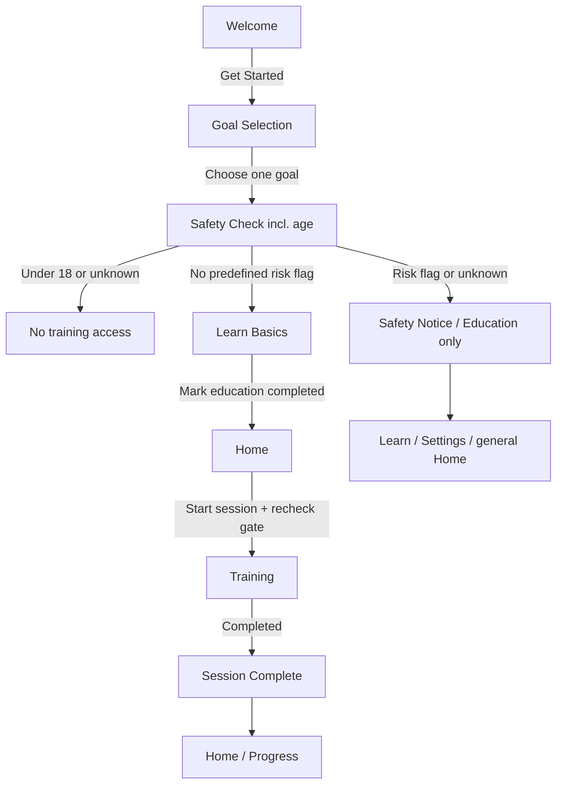
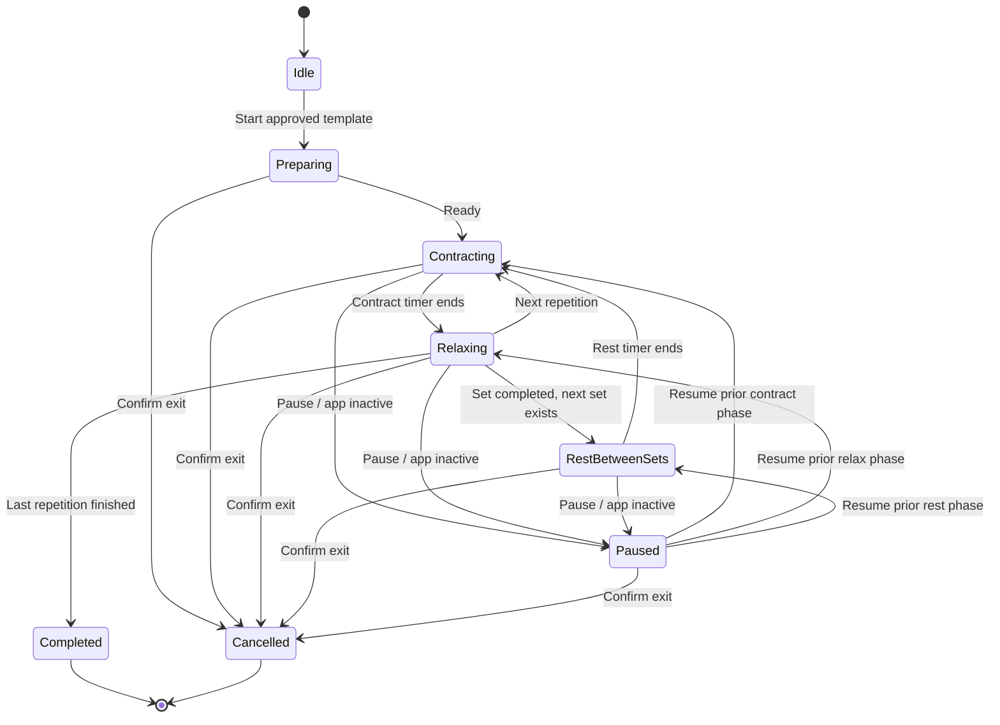

# Control — USER_FLOW.md

> **User Flow / Navigation / Interaction / State Specification**  
> **版本：** 0.2.0 · 12-screen Gradient UI Baseline  
> **日期：** 2026-10-23  
> **平台：** iOS 17+ / SwiftUI  
> **UI 文案：** English，本文：中文  
> **关联：** `PRD.md`、`DESIGN.md`、`References/control-ui-12screens.png`  
> **用途：** 交给 Cursor 直接实施路由、业务状态、按钮行为和验收测试。

---

## 0. 全局原则

1. **一个事实来源：** UI 显示和业务状态由同一个 Model / Store 决定；不能两个页面分别维护互相矛盾的训练数量或安全状态。
2. **先安全后训练：** 年龄确认、安全筛查、基础教学、已审核模板，缺一不可。
3. **训练锁全局生效：** Home、Train Tab、深链接、回退、恢复 App 都不能绕过训练入口守卫。
4. **隐私优先：** 首版无强制账号、无云同步、离线可运行；默认只持久化最小必要状态。
5. **可理解的反馈：** 每个按钮都有结果或说明；加载/禁用/失败/退出均有明确反馈。
6. **演示与上线分离：** `Preview` 数据只供 UI 测试，正式版首次安装所有 Session 指标均为真实 0。
7. **非诊断：** 风险筛查用于保守的入口分流，不判断医学状况；动画表示节奏，不宣称实时测量盆底肌。

---

## 1. 页面地图与 Router

### 1.1 页面级别

```text
AppRoot
├── OnboardingStack [尚未完成必要引导]
│   ├── WelcomeView                 # 1
│   ├── GoalSelectionView           # 2
│   ├── SafetyCheckView             # 3（包含 18 岁确认）
│   ├── SafetyNoticeView            # 条件页（不计 12 屏）
│   └── LearnBasicsView             # 复用 Learn 内容，必修检查点
│
├── MainTabShell [引导已完成 或 受限教育模式]
│   ├── HomeTab → HomeView          # 4
│   ├── LearnTab → LearnView        # 8
│   │              └── LessonDetailView
│   ├── TrainTab → TrainingEntryView（P0）
│   │              ├── ChooseSessionView（P1）   # 10
│   │              └── MyRoutineView（P1）       # 9
│   ├── ProgressTab → ProgressView  # 7
│   │                 └── JourneyView（P2）       # 12
│   └── SettingsTab → SettingsView  # 11
│
└── FullScreenTrainingFlow [仅通过统一的训练 gate 进入]
    ├── TrainingView                # 5
    ├── SessionCompleteView         # 6
    └── Exit / Safety Alert
```

- **底部固定 5 Tab：** Home / Learn / Train / Progress / Settings。
- `My Routine` 和 `Choose a Session` 不是独立 Tab。`Your Journey` 不是独立 Tab。
- 训练流程从任意合法入口启动后采用全屏呈现，隐藏 Tab；用户完成或放弃后返回原 Tab / Home。
- P0 `TrainingEntryView` 可以是一张基础 Session 入口卡；如果实现一个审核模板，不需要先做三张假的训练卡。

### 1.2 入口及导航重启规则

- **全新用户**：从 Welcome 开始，不允许直接跳过安全问题与教学。
- **中断引导的用户**：根据持久化 `onboardingStep` 返回合理未完成步骤；未提交的筛查答案不能伪装成已审核完成。
- **完成引导的用户**：默认打开 Home。
- **安全受限用户**：确认已阅读 SafetyNotice 后，保存教育模式的首次引导完成状态，允许进入 `Education only` 的 Home、Learn、Progress、Settings；Train 显示不具诊断性质的限制提示，不提供可绕过的开始按钮。
- **训练进行中被系统打断**：返回 App 时保持暂停/提供中断处理，不自动启动；不把暂停中的 Session 计入完成。
- **发生 trainingHold 的用户**：历史记录可读、教育内容可读；任何新训练入口都阻止。
- **深链接 / 恢复导航状态**：目标是 Training 或 Session Complete 时，必须重新执行入口与 Session ID 检查，不依赖上个 View 曾经通过安全检查。

---

## 2. 全局状态枚举与 Gate

### 2.1 用户偏好及安全状态

```swift
enum Goal: String, Codable {
    case improveControl
    case betterPerformance
    case generalPelvicHealth
    case recoveryInformation   // Education only
}

enum OnboardingStep: String, Codable {
    case welcome, goals, safetyCheck, learnBasics, finished
}

enum SafetyAccessStatus: String, Codable {
    case notScreened
    case noPredefinedFlag
    case educationOnly
}

struct UserPreferences {
    var adultConfirmed: Bool = false
    var primaryGoal: Goal? = nil
    var onboardingStep: OnboardingStep = .welcome
    var onboardingCompleted: Bool = false
    var basicEducationCompleted: Bool = false
    var safetyAccessStatus: SafetyAccessStatus = .notScreened
    var trainingHold: Bool = false
    var soundEnabled: Bool = true
    var hapticsEnabled: Bool = true
}
```

> `noPredefinedFlag` 的含义只是“未触发本应用的预设风险分流规则”，**不是医学意义上的训练适宜性确认**。

### 2.2 唯一训练入口守卫

```swift
func canStartTraining(
    preferences: UserPreferences,
    template: TrainingTemplate?
) -> Bool {
    preferences.adultConfirmed
    && preferences.onboardingCompleted
    && preferences.basicEducationCompleted
    && preferences.safetyAccessStatus == .noPredefinedFlag
    && !preferences.trainingHold
    && template?.isApprovedForRelease == true
}
```

**必须调用的时机：**
- 点击 Home Today's Training。
- 点击 Train Tab 内 Start/Choose Session。
- 从 My Routine / Journey / 通知进入 Session。
- 恢复深链接，切换账号/设备状态（未来），恢复 App。
- 在新训练 Session 初始化之前再次检查；仅通过一个 View 的按钮状态禁用是不够的。

**P0 Gate 失败的 UI 策略：**

| 条件 | 界面反馈 | 导航 |
|---|---|---|
| 未成年或未确认年龄 | `Training is for adults 18+.` | 无训练入口；查看说明/退出 |
| 未做筛查 | `Complete the safety check first.` | → SafetyCheck |
| 存在风险/回答未知 | `Training isn't available based on your answers. You can explore educational content.` | → SafetyNotice / Learn |
| 未完成 Basics | `Learn the basics before starting.` | → LearnBasics |
| 训练后报告不适/hold | `Please stop training and seek professional guidance if symptoms persist.` | → SafetyNotice |
| 没有已审核模板 | `Training is not available yet.` | → Learn / Home；记录日志，不展示假 Session |

**安全注意：** 上面是产品示例文案，公开发布前须经合适的临床人员确认；Hold 的恢复策略也必须有经审核的安全机制，而不是无条件按一下解除。

---

## 3. 核心用户旅程：初次使用

### 3.1 流程图



### 3.2 S01 Welcome

**可见内容：** 品牌 logo、tagline、价值点、`Get Started`。原型右下角的 `I already have an account` 在 P0 无账户功能时隐藏。

**事件：**

| 触发 | 校验 | 数据变化 | 下一步 |
|---|---|---|---|
| `Get Started` | 无 | `onboardingStep = .goals` | GoalSelection |
| 冷启动且引导中断 | 读 `onboardingStep` | 无 | 跳到未完成步骤 |

### 3.3 S02 Goal Selection

**字段：** `primaryGoal`，单选且必选。

选项：`Improve control` / `Better performance` / `General pelvic health` / `Recovery information (education only)`。

| 操作 | 行为 |
|---|---|
| 点击选项 | 当前选择卡高亮 + 勾选；之前选项取消选中 |
| 点击 Continue，尚未选择 | Continue 禁用，VoiceOver 告知原因 |
| 点击 Continue，已选择 | 保存 `primaryGoal`、`onboardingStep = .safetyCheck`，进入 SafetyCheck |
| 返回 Welcome | 选择保留在本次会话；用户可重新选择 |

**关于 Recovery：** 不是训练推荐入口。选择后仍可继续 SafetyCheck 了解风险，但最终只能进入一般教育与专业咨询提示，不进入通用训练。

### 3.4 S03 Health & Safety Check

图中共 5 类内容，**年龄确认在这一页第一题**，不用重复弹一个成年确认页面：

1. `Are you 18 years or older?`
2. `Do you currently have pelvic pain?`
3. `Do you have difficulty urinating?`
4. `Have you had prostate or related pelvic surgery?`（上线前需完善措辞与时间边界）
5. `Do you have a diagnosed condition or advice to avoid these exercises?`

**交互原则：**
- 不默认选择 `No`；单题若未答，视为 `unknown`。
- 每题应有 `Yes / No / Prefer not to say` 或合适的未知选项；不能强迫用户泄露敏感信息以换取训练许可。
- 专业审核决定最终问题集和风险分流规则；这里仅是保守初稿。
- 原始逐题敏感答案只在完成本次筛查时临时存在内存中；默认只存最终 `SafetyAccessStatus` 和年龄确认布尔值，不保存详情。

**提交逻辑：**

```text
IF adult_answer != YES:
  adultConfirmed = false
  route = NoTrainingAccess
ELSE:
  adultConfirmed = true
  IF any risk answer == YES OR any required answer == UNKNOWN
     OR primaryGoal == recoveryInformation:
       safetyAccessStatus = educationOnly
       route = SafetyNotice -> education-only shell
       // 用户确认已阅读 SafetyNotice 时，持久化 onboardingCompleted = true
       // 并将 onboardingStep = finished；basicEducationCompleted 仍为 false
  ELSE:
       safetyAccessStatus = noPredefinedFlag
       route = LearnBasics
```

**说明：** 若教育模式用户重启 App，应继续进入受限主界面，而不是无限循环重做筛查。`No` 风险答案不是疾病排除依据，系统不会声称健康证明。安全分流为保守的非诊断决策。是否允许用户日后重做筛查、如何解除受限，应由临床/产品审核规则明确；系统不能偷偷清除限制。

### 3.5 S08 Learn Basics — 入门必修

在 Learn 全部课程里挑选最少的必修单元：

- 盆底肌是哪里（一般知识）。
- 如何轻柔地识别收缩与**完全放松**。
- 呼吸自然、避免代偿、出现疼痛停止。
- 何时寻求专业支持。

**操作：** 滚动阅读/完成短单元 → `I've read the basics` → 保存 `basicEducationCompleted = true`、`onboardingCompleted = true`、`onboardingStep = .finished` → Home。

**限制：** 这里的完成标记代表用户**阅读/确认**，不意味着软件测定了动作正确性；不做“合格肌力测试”。

---

## 4. 日常导航：5 个 Tab

### 4.1 全局 Tab 转换

- Home → `HomeView`。
- Learn → `LearnView`，内部 `Basics / How to / Common Mistakes` 分类切换，点击内容进入 `LessonDetailView`。
- Train → `TrainingEntryView`（P0：已审核基础 Session 入口；P1：ChooseSession + MyRoutine）。
- Progress → `ProgressView`（P2 才提供 Journey 独立入口）。
- Settings → `SettingsView`。
- Tab 更换不改变已有真实 Session；训练中的导航用全屏控件，不能被 Tab 意外打断。

### 4.2 S04 Home

**数据加载：** 当天本地日期、最近 7 天已完成训练日、累计完成次数/时长/连续天数、可用基础模板。

| 控件 | 行为 | 失败/空状态 |
|---|---|---|
| Today's Training | `canStartTraining` → 启动 Training | 被 gate 阻止时显示对应说明/学习入口 |
| Weekly Calendar | 显示每一天是否有已完成会话 | 0 数据显示未完成状态，不显示虚构勾选 |
| Summary Cards | 真实统计 | 新用户显示 0，并解释数据从练习后产生 |
| Bottom Tabs | 切换 Home / Learn / Train / Progress / Settings | Tab 必须可访问 |
| Notification bell（图中） | P1 通知入口 | P0 未开发则隐藏 |

**页面刷新：** 回到 Home、前台恢复、训练完成时重新基于持久化数据计算，不依赖页面本地缓存统计。

### 4.3 S08 Learn

- 顶部 `Basics / How to / Common Mistakes` 可切换已实现的内容分类。
- 选择课程行/封面 → `LessonDetailView`。
- 教学图示的播放按钮只有存在真正视频或交互说明时才出现；不能显示无效 ▶。
- 必修内容完成后同步更新 `basicEducationCompleted`。
- 风险用户允许在 Learn 浏览一般教育内容，课程不得包含对其个体的康复处方。

### 4.4 Train Tab（P0/P1）

**P0：** 主界面 `TrainingEntryView` 显示唯一已审核基础 Session（若无已审核模板，提示不可用）。点击 Start 经过统一 gate 进入全屏 Training。

**P1：**
- `ChooseSessionView`：Quick / Standard / Extended；用户选择 → 校验模板审核状态与 gate → Training。
- `MyRoutineView`：训练日期、计划条目、休息日、提醒配置；用户点击当日课程 → 同样 gate → Training。
- 更改计划参数需经范围校验与保存确认；改计划不应重写历史真实 Session。
- 任何不可用类型不应可启动或表现为可启动。

### 4.5 S07 Progress / S12 Journey

- `ProgressView` 默认 7D；用户选择 30D 后从已存会话重新聚合。
- 卡片/柱图可点击时才标明交互，并显示该日真实次数与时长。
- 新用户展示 `No sessions yet`；不放造假的柱图和日期打卡。
- `JourneyView`（P2）从 Progress 的二级入口进入；节点基于真实完成次数/活跃周数，未达成不预亮。
- Insights 若未来开发，归属于 Progress 二级内容，不另增底部 Tab。

### 4.6 S11 Settings

| 项目 | 类型 | P0/P1 | 操作/数据 |
|---|---|---|---|
| Sound Guidance | Toggle | P0 | 立即更新 `soundEnabled`；训练中下一阶段生效 |
| Haptic Feedback | Toggle | P0 | 立即更新 `hapticsEnabled` |
| Safety Information | Navigate | P0 | 查看真实安全说明，必要时可重做经审核的流程 |
| Privacy Policy | Link | P0 | 打开上线前验证存在且可访问的政策页面 |
| Delete All Data | Destructive | P0 | 二次确认 → 删除本地 Sessions/Feedback/必要相关状态 → 回到 Welcome 或重置状态 |
| Voice | Selector | P1 | 只展示已实现可试听的声音 |
| Training Reminders | Toggle | P1 | 用户主动启用时请求本地通知许可；拒绝时保持 Off |
| Reminder Times | Time picker | P1 | 选择时间并重建本地通知；不影响已存历史 |
| Export Data | Action | P1 | 生成用户可读文件并调用系统共享面板；注意敏感信息范围 |
| Motivational Messages | Toggle | P1 | 仅有真实通知逻辑时可开启 |

**删除数据的提示：** 清楚解释删除本地应用数据的范围；不能保证系统已有备份瞬时被销毁。

---

## 5. 核心训练状态机（S05）

### 5.1 状态图



**实现时注意：** `Paused` 需要保存 `phaseBeforePause` 与 `remainingPhaseTime`，图中 `Resume` 是对原阶段恢复，不是重置当前练习。

### 5.2 核心状态模型

```swift
enum TrainingPhase {
    case idle
    case preparing
    case contract
    case relax
    case restBetweenSets
    case paused
    case completed
    case cancelled
    case interrupted
}

struct TrainingRuntime {
    let sessionID: UUID
    let templateID: String
    var phase: TrainingPhase
    var phaseBeforePause: TrainingPhase?
    var currentSet: Int
    var completedRepetitions: Int
    var phaseRemainingSeconds: TimeInterval
    var activeElapsedSeconds: TimeInterval
    var isPersisted: Bool
}
```

### 5.3 状态行为与数据变化

| 事件 | 前置状态 | UI 变化 | 数据行为 |
|---|---|---|---|
| Start | idle + gate true | Preparing 或 Contract | 创建 runtime Session ID，但未写 completed |
| 开始 Contract | preparing / relax / rest | 环形计时+Contract 文案 | 记录阶段单调时钟锚点 |
| Contract 倒计时结束 | contract | 切换 Relax 文案/颜色/引导 | 不立即视为完成一个有效循环 |
| Relax 倒计时结束 | relax | 下一次 Contract 或 Rest/Completed | **完成完整 Contract+Relax 对**才累计 repetition |
| Pause | active phases | `Paused`，圆环停住，按钮变 Resume | 冻结有效时长和剩余阶段时间 |
| Resume | paused | 恢复上一阶段，继续剩余时间 | 重建单调时钟锚点，不重复扣秒 |
| App 进入 inactive/background | active | 暂停 + 退出需用户处理 | 不自动在后台完成训练 |
| Exit | active/paused | 弹确认 `End session?` | 确认取消后标记 cancelled，**不记为完成** |
| Final stage ends | relax | 进入 Session Complete | 幂等保存唯一 completed Session |
| App 被系统终止 | active | 重新启动显示提示 | 若已保存中断快照 → interrupted；不当作 completed |

### 5.4 倒计时计算

- 以 `ProcessInfo.processInfo.systemUptime` 等单调时间为持续时间锚点，在 active 阶段通过 `now - phaseStartUptime` 计算 elapsed。
- UI 刷新机制只负责显示，不决定经过时间；防止卡顿/系统调度导致计时飘移。
- 暂停时冻结累计 active 时间与阶段剩余时间；恢复时重新设锚点。
- 剩余总时长由当前未完成各阶段的配置时间**重新聚合**，而不是写一个独立会失步的 Timer。
- 处理计时器跨多个阶段的边界、设备锁屏、通知覆盖、音频中断、快速点 Pause/Resume；不会重复进入 completed。
- 不得通过改变动画帧率或系统环境时间来改变训练完成数量。

### 5.5 提示文案与反馈

- `Contract`: `Gently contract your pelvic floor. Keep breathing normally.`
- `Relax`: `Release fully and keep breathing.`
- `Paused`: `Paused. Resume when you're ready.`
- `Stop`: `Stop if you feel pain or discomfort.`

这些文案是产品示例，**须经临床审查**。语音、振动与视觉提示同步但不互相依赖；关闭声音、关闭振动后 App 仍可完整使用。

### 5.6 退出确认

用户在训练途中按 Back / Close：

```text
End session?
Your current session won't count as completed.
[Continue training]   [End session]
```

- `Continue training` → 保留并返回 Paused / 原阶段（出于确认弹窗期间不应继续隐式计时，建议弹出时暂停）。
- `End session` → 记录 cancelled（可只留本地调试信息，前台统计排除）；返回原入口。
- `Completed` Session 没有退出取消逻辑；一旦正式完成保存则只可删除历史数据，不应随意撤销计数。

---

## 6. S06 Session Complete 和风险反馈

### 6.1 进入完成页

**前提：** 当前训练状态为 `completed`，`TrainingSession(id: UUID)` 已以唯一 ID 成功保存。

展示：
- `Great job!`
- `Completed reps`：实际完整 Contract + Relax 循环数。
- `Practice time`：实际 active 时间，排除 Pause 时间。
- `How did you feel today?`：四个可选难度。
- 独立问题 `Did you experience pain or discomfort?`。
- `Save & Continue`。

**注意：** 图中 `Notes (optional)` 不足以承载医疗安全信号；P0 必须加上独立 Yes/No/Prefer not to say，Notes 可以先不实现。

### 6.2 难度反馈交互

| 用户操作 | 数据 | UI |
|---|---|---|
| 选择 Easy / Comfortable / Challenging / Too hard | `difficulty` 更新为枚举 | 单选高亮，其他取消 |
| 不选择 | `difficulty = nil` | 可正常继续 |
| 不适选 No | `discomfortReported = false` | 可正常回 Home/Progress |
| 不适选 Yes | `discomfortReported = true` | 展示安全建议，`trainingHold = true` |
| 选 Prefer not to say / 跳过 | `discomfortReported = nil` | 不推断有/无风险，不诊断 |
| 点击 Save & Continue | 更新关联该 Session ID 的 Feedback | 防止双击重复插入 |

**数据先后：**
1. Training 正常完成 → 立即持久化 completed Session（即使用户没填反馈）。
2. Session Complete 用户选择难度/不适 → 保存/更新 `SessionFeedback(sessionID)`。
3. 若报告不适 → 设置 `trainingHold` 并显示 Stop / Seek guidance 提示。
4. 选择回 Home 或 Progress，重新计算指标。

**实现建议：** `TrainingSession.id`、`SessionFeedback.sessionID` 均唯一；保存事务/Repository 进行 upsert，不能靠按钮点击次数计数。

### 6.3 特殊情况

- 进入 Session Complete 后直接杀进程：已完成会话仍存在；反馈可空。
- 重进完成页：按相同 `sessionID` 读取，不新建 completed Session。
- 页面无法保存用户难度：显示可重试的信息，既有完成记录不受影响。
- 用户填 `Too hard` 且没有明确不适：不应自动诊断；可显示降低强度和审慎求助的一般提示（文案审核）。

---

## 7. Progress 统计与数据一致性

### 7.1 数据来源

```text
CompletedSessions = TrainingSession WHERE status == completed
TotalSessions     = count(CompletedSessions)
TotalSeconds      = sum(activeDurationSeconds)
PracticeMinutes   = UI format(TotalSeconds)
TrainingDayKeys   = distinct(completedSession.localDayKey)
CurrentStreak     = contiguous day keys from today, or yesterday if today not trained yet
```

`localDayKey` 建议按**完成时设备当地日历日期**保存（如 `2026-10-23`），防止用户跨时区后历史打卡突然迁移；跨区日界和夏令时列入 QA。

### 7.2 具体规则

- 所有卡片、周日历、月历、Journey 使用同一套 `TrainingStatisticsService`。
- 一天完成多次练习：TotalSessions 全部计数，但 TrainingDay 只计 1 天。
- 未完成、取消、中断的会话不出现在完成进度统计。
- 当前日期发生变化后重新计算周/月区间，不能永远固定 UI 原型中的 March。
- 无历史记录时图表为空状态；删除数据后所有进度同步清零。
- `82% felt good`、`5 day streak` 等只有计算基础清楚且数据真实时才能显示；主观感受须标记 self-reported。

---

## 8. 计划、选择课程与提醒（P1 预留）

### 8.1 Choose Session

1. 用户从 Train 进入 ChooseSession。
2. 仅显示存在的已审核模板；每卡绑定 `template.id`、时长、总次数、类型。
3. 点卡 → Session Detail（可选）→ Start。
4. Start 执行同一个 `canStartTraining`。
5. 训练完成返回 Progress/Home，或用户按 Back 返回 Session 列表。

### 8.2 My Routine

1. 用户打开 My Routine → 查看本周安排。
2. 点击日程项 → 读取模板 → Start 前再次安全校验。
3. `Customize Plan` 只有实现参数校验、恢复默认、保存、冲突状态后才展示。
4. 休息日不计“未完成失败”；“完成百分比”须说明分母是哪些计划课次。

### 8.3 Local Notifications

1. Settings → Training Reminders → 用户明确开启。
2. 请求 iOS 通知权限；若拒绝，则 UI Off 或明确提示需要到系统设置启用。
3. 选择 Reminder Times，创建/更新本地日程；遵循用户训练日和休息日。
4. 点击通知 → 进入 App；经过状态恢复和安全 gate 后才允许进入训练。
5. 关闭提醒 → 取消待发送通知；不改变历史训练数据。

---

## 9. 异常场景与边界测试

| ID | 场景 | 预期结果 |
|---|---|---|
| E01 | 没答年龄或回答未满 18 | 无法进入训练；明确限制原因 |
| E02 | 筛查任一高风险回答或未知 | 进入教育模式；所有训练入口受限 |
| E03 | 首页从后台恢复，已有 trainingHold | 训练入口立即锁定 |
| E04 | 没完成 Learn Basics，使用深链接 | 强制回 Basic Education，不启动计时 |
| E05 | 模板缺失/未经审核 | 显示不可用，绝不临时给默认“4 秒×8”当临床训练 |
| E06 | 快速双击开始 | 只创建一个 runtime Session |
| E07 | 快速暂停/继续/切后台 | 计时不会重复、不倒退、不自动 Resume |
| E08 | Contract 或 Relax 中退出 | 弹确认；取消不计 Completed |
| E09 | 完成页连续点击保存 | 一个 Session、一个 Feedback upsert |
| E10 | 完成后尚未反馈就强制关 App | 训练已被保存，反馈可为空 |
| E11 | 报告疼痛/不适 | 设置 trainingHold，下次不可自动训练 |
| E12 | 删除全部本地数据 | 训练、统计、反馈正确清空；回到相应引导状态 |
| E13 | 无历史用户查看 Progress | 正确零状态，没有虚构图表 |
| E14 | 无网络 | P0 引导、训练、统计正常可用 |
| E15 | 开大字号/VoiceOver | 安全问答不裁切，按钮可读，计时状态可感知 |
| E16 | 横跨当地午夜完成练习 | 完成归属日定义一致，Streak 不错乱 |
| E17 | 系统进程意外终止 | 不凭恢复计时自动把 Session 标记完成 |
| E18 | 从 Journey/提醒尝试打开已限制 Session | 统一 gate 拦截 |

---

## 10. 状态、持久化及架构建议

### 10.1 推荐数据层分工

```text
AppRouter              // 判断首次引导 / education-only / 主 Tab / training flow
UserPreferencesStore   // 偏好与安全入口状态
TrainingTemplateStore  // 经审核版本的训练模板
TrainingEngine         // 纯状态机与时钟计算，不写 UI
TrainingSessionStore   // SwiftData 唯一会话保存、upsert、查询
TrainingStatistics     // 统一聚合统计
NotificationManager    // P1，仅用户授权后启动
```

### 10.2 持久化时机

| 数据 | 何时保存 | 机制建议 |
|---|---|---|
| Goal | 用户点击 Continue | `@AppStorage` / UserPreferences Store |
| 安全整体状态 | 筛查提交后立即 | 仅最小状态；不存详细敏感答案 |
| Basic Education completion | 用户主动确认完成 | 持久化布尔值 |
| 声音/振动设置 | 用户切换时 | 实时持久化并作用于训练 |
| TrainingSession | 正常 completed 事件恰好一次 | SwiftData unique ID / Repository upsert |
| Feedback | 选择 `Save & Continue` 时 | 关联唯一 Session ID 更新 |
| 取消/中断运行时 | 退出/恢复时 | 不写成已完成记录，可保留受限状态用于恢复/调试 |

### 10.3 UI / Model 单向数据流

- `TrainingView` **观察** `TrainingEngine` 状态，不自己持有第二个倒计时真值。
- `SessionCompleteView` 用 `sessionID` 查询真实保存结果，不从测试硬编码卡片读取。
- `HomeView` 和 `ProgressView` 都读取 `TrainingStatisticsService`。
- `SafetyAccessStatus` 与 `trainingHold` 由统一入口逻辑读取，绝不只靠按钮颜色决定可达性。

---

## 11. Cursor 实现顺序（按风险和依赖排序）

### Iteration 1 — 视觉与导航骨架

- [ ] 创建 `ControlTheme`、`GradientBackground`、`GlassCard`、`PrimaryPillButton`。
- [ ] 搭建 5 Tab；为当前未实现的 P1/P2 页面隐藏入口。
- [ ] 首先实现 `HomeView`、`TrainingView`、`SessionCompleteView` 的 Preview/UI。
- [ ] 所有 Preview 示例写在 `#Preview`/fixtures 中，不混入 App 正式数据。

### Iteration 2 — 真实训练模型

- [ ] 用 `TrainingEngine` 实现 stage 状态转换、单调计时、暂停与退出。
- [ ] 完成 Session 唯一持久化、完成页反馈 upsert。
- [ ] 加入 Home/Progress 的真实训练记录查询。
- [ ] 补充异常测试（快速点击、后台、中断、冷启动）。

### Iteration 3 — 必备安全与首访

- [ ] Welcome → Goal → Safety → Basics → Home。
- [ ] 训练 guard 在所有入口一致生效，受限用户教育模式能正常使用。
- [ ] 完成 Settings 声音/振动、数据删除、隐私、风险求助说明。
- [ ] 请专业人员审查训练模板、筛查内容、医疗文字和人体插画。

### Iteration 4 — 可用 MVP 质量收尾

- [ ] UI 与参考图逐屏比对字体、渐变、间距、选中态与安全区。
- [ ] 空状态、无网络、删除后状态、可访问性回归测试。
- [ ] 真机与 TestFlight 测试，完成发布前隐私/安全检查。

### Iteration 5 — P1/P2 扩展

- [ ] Session 选择、Routine/周计划、提醒。
- [ ] 更丰富的 Progress Insights、Journey/里程碑。

---

## 12. 实际验收用用户故事

**Story A — 首次使用且无风险标记：** 用户安装 → 点击 Get Started → 选择 Improve control → 在 Safety Check 确认成年并完成问答 → 阅读基础教学 → Home → 启动已审核基础 Session → 完成 → 保存反馈 → Progress 的次数从 0 到 1。

**Story B — 筛查存在风险：** 用户选择 Goal → 筛查提示盆腔疼痛/排尿困难/术后情况 → Safety Notice → 可以看 Learn，但无法从 Home 或 Train 启动通用 Session。

**Story C — 未完成练习：** 用户开始训练 → Contract/Relax 中按 Pause → 继续 → 决定退出 → 确认放弃 → 返回 Home；Completed Sessions 不增加。

**Story D — 有不适：** 用户完成训练 → 报告 discomfort Yes → 保存反馈并显示求助提示 → 下一次进入 Home，训练入口因 hold 受限。

**Story E — 隐私与真实数据：** 用户打开 Progress 查看历史 → Settings 点击 Delete All Data → 二次确认 → 历史数据清空、统计归零、回到重置后的适当引导，不显示设计图演示数字。

**最终交付标准：** 每条 Story 在 Xcode Simulator 和至少一台真机上可复现；正式版本不依赖虚假模拟数据、不绕过安全约束，所有 P0 主按钮都可执行真实操作。
